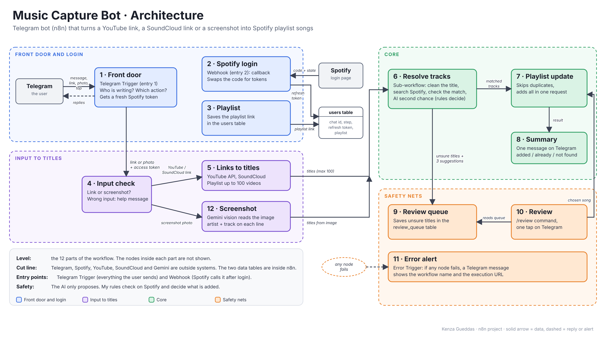

# Music Capture Bot

A Telegram bot built with n8n that adds songs to my Spotify playlist. I send it a YouTube video or playlist, a SoundCloud track, or a screenshot of a tracklist, and it does the boring part for me.



## Why I built it

I love finding new music on YouTube and SoundCloud, but putting these songs in Spotify is slow. I have to search every song by hand, and YouTube titles are messy ("Official Video", "Lyrics", emojis, "ft. someone"...). With a long playlist it takes forever, so I wanted to automate it.

## What it does

1. I send a link (or a screenshot) to the bot on Telegram.
2. The bot turns it into a list of titles (up to 100 videos).
3. For each title, it cleans the text, searches Spotify and checks that the result is really the right song.
4. It skips the songs that are already in the playlist and adds the new ones in one request.
5. It sends me a short summary: added, already there, not found.
6. If it is not sure about a title, it does not guess. The title goes to a review queue, and I choose the right song with one tap using `/review`.

My rule for the AI is: **the AI proposes, the rules decide.** The AI (Gemini Flash-Lite) only reads screenshots and gives a second chance to titles that my rules refused. My own code checks everything on Spotify before anything is added.

## How it works

The workflow has 12 parts, and two entry points: the Telegram Trigger (everything the user sends) and a Webhook (Spotify calls it after the login).

- **1. Front door:** every Telegram message arrives here. It finds the user and a Switch sends the message to the right action.
- **2. Spotify login:** each person connects their own Spotify account with OAuth, so I never see a password. The webhook receives the code and saves the tokens.
- **3. Playlist:** the person sends the link of their playlist, and I save it.
- **4. Input check:** the bot checks what was sent. A wrong message gets a help message instead of an error.
- **5. Links to titles:** the YouTube API and SoundCloud oEmbed turn a link into a list of titles.
- **6. Resolve tracks:** a sub-workflow that cleans each title, searches Spotify and checks the match. If my rules refuse a title, the AI gets one second chance, and the same rules check again.
- **7. Playlist update:** it reads the playlist, skips duplicates and adds the new songs.
- **8. Summary:** one clear message on Telegram.
- **9. Review queue:** unsure titles are saved with 3 Spotify suggestions.
- **10. Review:** `/review` shows the cases with buttons.
- **11. Error alert:** an Error Trigger sends me a Telegram message with the workflow name and the execution link.
- **12. Screenshot:** a vision AI reads the artists and tracks in the picture, then the same workflow continues.

### Data

I use two n8n data tables:
- `users`: chat id, step, oauth state, refresh token, playlist id and playlist name. This is what makes the bot work for several people.
- `review_queue`: the unsure titles with their 3 suggestions.

### Why a sub-workflow?

The matching is the hardest part and every input (YouTube, SoundCloud, screenshot) uses it. So I wrote it once in a sub-workflow called with Execute Workflow. The main workflow stays readable and I can test the matching alone.

## Commands

- `/connect`: link my Spotify account
- `/help`: show what the bot can do
- `/playlist`: change the playlist
- `/review`: choose the songs the bot was not sure about
- `/disconnect`: delete my data

## What you need

- Docker Desktop (Docker and Docker Compose)
- A Telegram bot token (from @BotFather)
- A Spotify developer app (Client ID and Client Secret)
- A Google AI (Gemini) API key
- A YouTube Data API key
- A public HTTPS address for n8n (a tunnel like Cloudflare Tunnel or ngrok). Telegram and Spotify need it for the webhooks, and `localhost` is not enough.

## How to run it

1. Clone the repo, or download it as a ZIP:
```bash
   git clone https://github.com/kenza-gueddas/music-capture-bot.git
   cd music-capture-bot
```
2. Copy `.env.example` to `.env` and fill in your own values (see the table below). Never commit `.env`.
3. Start n8n and Postgres:
```bash
   docker compose up -d
```
4. Check that both services are running (Postgres should be `healthy`):
```bash
   docker compose ps
```
5. Open http://localhost:5678 and create your n8n account.
6. Import the workflows from the `workflows/` folder with **Import from file**. Import `music-capture-bot-sub.json` first ("Music capture bot — Resolve tracks (with AI)"), then `music-capture-bot-main.json`.
7. In the main workflow, open the **Resolve tracks** node and select "Music capture bot — Resolve tracks (with AI)" again, because its id changes after the import.
8. Create these credentials in n8n and link them to the nodes that use them:
   - **Telegram account** (Telegram API): the bot token from @BotFather
   - **Spotify** (Basic Auth): the Client ID as user and the Client Secret as password, used by the "Get Spotify token" and "Exchange code" nodes
   - **Query Auth account** (Query Auth): the YouTube Data API key, used by "YouTube: playlist" (parameter `key`)
   - **Google Gemini(PaLM) Api account** (Google Gemini API): the Gemini key, used by the Gemini chat model nodes
9. In the Spotify developer dashboard, add this Redirect URI: `<your WEBHOOK_URL>webhook/spotify-callback`.
10. Publish the sub-workflow, then publish the main workflow.

**What I tested:** I checked that the stack starts with Docker (`docker compose up -d`, Postgres is healthy) and that both workflows import into n8n.
My live demo runs on my n8n Cloud.

To stop everything: `docker compose down`. My data stays in the Docker volumes.

### Environment variables

- `N8N_VERSION` and `POSTGRES_VERSION`: pinned image versions (no `latest`)
- `POSTGRES_USER`, `POSTGRES_PASSWORD`, `POSTGRES_DB`: database settings
- `N8N_ENCRYPTION_KEY`: key n8n uses to encrypt the credentials
- `GENERIC_TIMEZONE`: time zone
- `WEBHOOK_URL`: the public HTTPS address of n8n, with a `/` at the end

## How to test it

1. Send `/start` to the bot and follow the Spotify link.
2. Send the link of a playlist you created yourself.
3. Send a short YouTube playlist (5 to 8 videos) and read the summary.
4. Send `/review` and choose a song for an unsure title.
5. Send something that is not a link, to see the help message.
6. Send the same link twice: no duplicate is added.
7. Send a screenshot of a tracklist.
8. Look at the **Executions** tab in n8n: the runs should be green.

Spotify limits the number of requests per minute (error 429). If it happens, wait 30 to 60 minutes and use short playlists for tests.

## Limits and next steps

What does not work yet:
- I depend on outside services (Spotify, YouTube, Gemini). If one changes, I have to update the workflow.
- The Spotify rate limit slows down very long playlists.

Ideas for later:
- Better matching, for example by learning from the songs I fix in the review.
- SoundCloud playlists and several screenshots at once.
- More sources (TikTok, Instagram, Shazam) and more music services (Apple Music, Deezer).
- A web page for the login and a real app on top of the workflow.
- Voice messages: I could send a voice note like "add Low Tide by Kaya", and the bot would turn the speech into text and add the song.

## Project structure

```
workflows/            exported n8n workflows (JSON)
docs/                 architecture diagram and screenshots
docker-compose.yml    n8n + Postgres
.env.example          environment variables (no secrets)
```

## Author

Kenza Gueddas, bachelor in data and AI.
